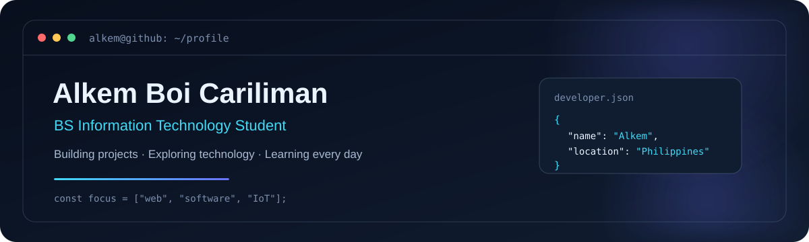

<picture>
  <source media="(prefers-color-scheme: dark)" srcset="./dark.svg">
  <source media="(prefers-color-scheme: light)" srcset="./light.svg">
  
</picture>

# Hi, I'm Alkem Boi Cariliman 👋

**BS Information Technology Student · Aspiring IT Professional · Developer**

I enjoy building practical applications, exploring web technologies, and learning how software and hardware work together.

---

### About me

- 🎓 BS Information Technology student at **Cebu Technological University – Argao Campus**
- 💻 Interested in web development, software development, databases, and IoT
- 🌱 Currently strengthening my programming and development skills
- 📍 Cebu, Philippines

### Tech stack

**Languages**

`Python` · `Java` · `JavaScript` · `PHP` · `C`

**Web development**

`HTML` · `CSS` · `React` · `Vite`

**Database and tools**

`MySQL` · `Git` · `GitHub` · `VS Code` · `XAMPP` · `Figma`

### Selected academic projects

| Project | Description | Technologies |
|---|---|---|
| **D.A.T.A. – Dalaguete Tourist Application** | A tourism application concept designed to present information about Dalaguete. | Python, PySide6, MySQL |
| **Smart IoT-based Cleanroom Monitoring System** | Monitors temperature and humidity and sends alerts through Telegram. | ESP8266, DHT22, Telegram, RemoteXY |
| **Study Track** | A student-focused system for organizing class schedules, assignments, and reminders. | PHP, MySQL |

### Certifications

- **Data Analytics Level III** — Call Center Academy, 120 hours (2026)
- **Operating Systems Basics** — Cisco Networking Academy (2026)
- **Prompt Like an Engineer** — DICT-ITU DTC Initiative through Cisco Networking Academy (2026)

### Education

**BS Information Technology**  
Cebu Technological University – Argao Campus  
Expected graduation: 2027

**Senior High School – ABM**  
Dalaguete National High School  
2023

---

<h2 align="center">📊 GitHub Contributions</h2>

  <picture>
    <source
      media="(prefers-color-scheme: dark)"
      srcset="https://raw.githubusercontent.com/Blackcodehihub/github-snake/output/github-snake-dark.svg"
    />
    <source
      media="(prefers-color-scheme: light)"
      srcset="https://raw.githubusercontent.com/Blackcodehihub/github-snake/output/github-snake.svg"
    />
    
  </picture>

---

*Always learning. Always building.*

